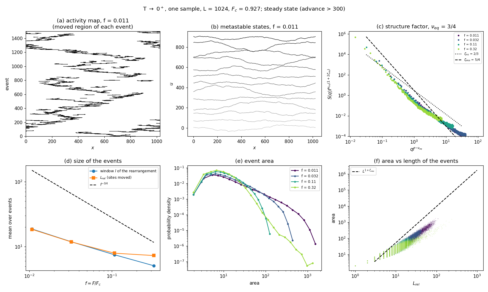
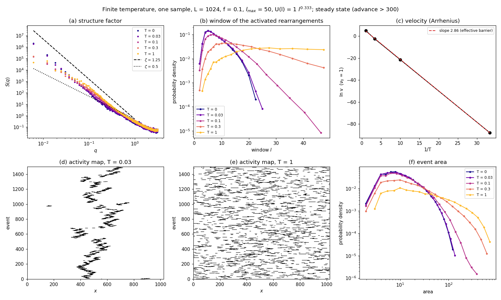
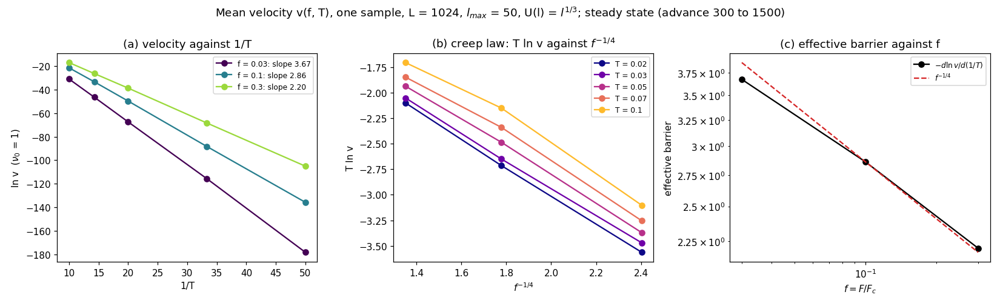
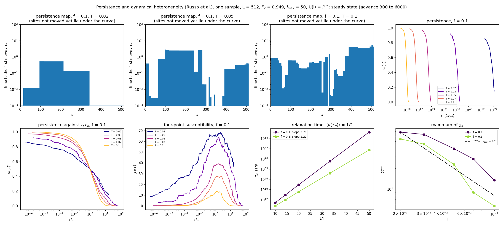

# creep-minimal-rearrangement

Creep of a directed elastic line in a random potential, driven below the depinning threshold, by thermally activated rearrangements followed by deterministic relaxations:

- **T → 0⁺**: the algorithm of Ferrero, Foini, Giamarchi, Kolton and Rosso [1]. It approximates the exact transition pathways of Kolton, Rosso, Giamarchi and Krauth [2, 3] (code: [krgk-creep](https://github.com/droyktton/krgk-creep)): the next metastable state is reached through the *smallest* compact rearrangement that lowers the energy, instead of the one with the smallest barrier.
- **T > 0**: its extension by Russo, Ferrero, Kolton, Rosso and Vandembroucq [4]. A kinetic Monte Carlo picks among all the energy-lowering rearrangements, with rates set by an assumed barrier U(ℓ).

The T → 0⁺ algorithm is the limit of the finite-temperature one, and both share the same code.

## Build, test and run

```
make                     # build/mr_creep (C++17, OpenMP)
make test                # internal checks; KRGK=path/to/krgk_creep make test also compares F_c
build/mr_creep --L 1024 --M 4096 --f 0.3 --events 10000 --out run1           # T -> 0+
build/mr_creep --L 1024 --M 4096 --f 0.3 --T 0.5 --events 10000 --out run2   # T = 0.5
```

Threads are set with `OMP_NUM_THREADS`.

Options (`build/mr_creep --help`):

| option | meaning | default |
|---|---|---|
| `--L` | line length (sites, periodic) | 64 |
| `--M` | period of the disorder along u; 0: not periodic (needs `--absolute`) | 1024 |
| `--mcut` | maximal slope \|u_{i+1} − u_i\| | 1 |
| `--disorder` | strength of the Gaussian disorder (std) | 1.0 |
| `--c` | elastic constant | 2.0 |
| `--f` | drive F/F_c (F with `--absolute`) | 0.5 |
| `--absolute` | `--f` is the force F; F_c is then not computed | off |
| `--seed` | seed of the disorder | 12345 |
| `--rng` | disorder generated on demand (`philox`) or stored as a table (`mt`) | `philox` |
| `--xi-x`, `--xi-u` | Philox disorder constant on rectangles of xi-x sites by xi-u along u | 1, 1 |
| `--events` | number of creep steps | 100 |
| `--advance` | stop earlier, once the mean position has advanced by this much | 0 (off) |
| `--lmax` | largest rearrangement window | L − 1 at T = 0, 50 at T > 0 |
| `--T` | temperature; 0 is the T → 0⁺ limit | 0 |
| `--U0`, `--theta` | barrier of a rearrangement of window ℓ, U(ℓ) = U0·ℓ^θ (T > 0) | 1, 1/3 |
| `--kmc-seed` | seed of the kinetic Monte Carlo | 1 |
| `--conf-every` | write the metastable state every n steps to `configs.bin` (int32, L per record) | 0 (never) |
| `--save-events` | write α, the activated configuration and γ of every step to `events.bin` (int32, 3 records of L) | off |
| `--save-moves` | write the time and the moved sites of every step to `moves.bin` (about 20 bytes per step) | off |
| `--skip` | the steady state starts once the mean position has advanced by this much; the velocity is measured from there | 0 |
| `--persistence` | T > 0: persistence and χ4 up to τ = X/v (needs `--skip`) | 0 (off) |
| `--checkpoint` | write `checkpoint.bin` every this many seconds of wall time | 0 (never) |
| `--walltime` | after this many seconds, or on SIGTERM, SIGINT or SIGUSR1 when checkpointing, write `checkpoint.bin` and exit with status 3 | 0 (off) |
| `--restart` | resume from `checkpoint.bin` in `--out` if it exists; exit 0 at once if the run is already done | off |
| `--out` | output directory | `.` |

**Checkpoints.** The checkpoint holds the line, the time and the steady-state counters, the state of the Monte Carlo generator, the persistence accumulators and open origins, and the sizes of the output files. On restart the output written after the checkpoint is cut, the windows are recomputed, and the run continues exactly as if it had not stopped: the outputs are identical bit by bit. The parameters must be the same as in the run that wrote it. The checkpoint is removed when the run ends. For a batch system, run with `--restart --walltime S` in a loop, or resubmit, until the exit status is 0.

Outputs:
- `params.txt`: the parameters, F_c and F.
- `critical.dat`: the critical configuration, the one that blocks the line at the last raise of F when locating F_c. Written unless `--absolute`.
- `events.dat`: one line per step, with columns
  - `step`;
  - `l`: window of the activated rearrangement;
  - `gain`: energy it lowers;
  - `L_act`: sites it moves;
  - `L_rel`: sites moved from α to the new metastable state γ;
  - `area`: Σ(γ − α);
  - `mean_u`, and `E`, the energy of γ;
  - `dt`: duration of the step at T > 0, in units of e^{U(2)/T}/ν₀ (0 at T = 0);
  - `i`: start of the activated window [i, i+l];
  - `x_left`, `extent`: the smallest arc [x_left, x_left + extent) that contains the moved sites (γ ≠ α). The moved set need not be contiguous, because the optimal path can touch the line inside the window.
- `moves.bin` (with `--save-moves`): per step, the time (a double; the step number at T = 0), the number n of runs of moved sites (int32), and n pairs (start, length) (int32).
- `summary.txt`: number of steps, advance and, in the steady state, steps, advance, time, velocity v and ln v. Times are in units of 1/ν₀, with rates ν₀·exp(−U(ℓ)/T). With `--persistence` it also gives τ_α and the maximum of χ4.
- `persistence.dat` (with `--persistence`): τ, ⟨π⟩, ⟨π²⟩ and χ4, in the steady state [4]:
  - π(τ) = (1/L) Σ_i p_i(τ), where p_i(τ) = 1 if site i does not move in [t₀, t₀ + τ];
  - the averages run over origins t₀ every τ_max/10;
  - χ4(τ) = L(⟨π²⟩ − ⟨π⟩²);
  - τ_α is defined by ⟨π(τ_α)⟩ = 1/2;
  - the grid of τ spans 10⁻³/v to X/v, where v is measured over the second half of the transient (advance `skip`/2 to `skip`).
  - Both are accumulated during the run: each origin keeps the time of the first move of every site.
- `s4.dat` (with `--persistence`): the four-point structure factor S4(q, τ) = (1/L)⟨|Σ_i p_i(τ) e^{iqi}|²⟩ on the same grid of τ, one row per τ: τ, then S4 at each q. The second comment line lists the q = 2πn/L: n = 1 to 16, then 8 per decade up to L/2. S4(q → 0) tends to χ4 when L is much longer than the correlation length of p_i.

**Correlation length.** `analysis/s4_length.py RUN_DIR ...` fits S4(q) at τ_α (or at the maximum of χ4, `--tau chi4`) to the Ornstein-Zernike form A/(1 + (qℓ)²), and also gives ℓ_half = 1/q_half with S4(q_half) = A/2. Runs that differ only in the seeds are averaged as samples of one point, with the number of origins as weight.

## Demo

`demo/run_demo.sh` runs the examples below (about 40 minutes with 3 parallel jobs) and `demo/plot_demo.py` makes the figures.

The runs use Philox disorder, seed 1, not periodic in u (`--M 0`), and L = 1024 (F_c = 0.927, computed with M = 4096), except the persistence runs, which use L = 512 (F_c = 0.949). Unless stated otherwise, each run continues until the line has advanced by 1200, and the analysis keeps the steady state (advance > 300).

### T → 0⁺

F/F_c = 0.32, 0.11, 0.032 and 0.011.



- (a) Activity map at f = 0.011: the region moved by each event. The events form spatio-temporal clusters, as in Fig. 1 of [1].
- (b) Metastable states at f = 0.011.
- (c) Structure factor, rescaled by the crossover length ℓ_opt ∼ f^{−ν_eq}, ν_eq = 3/4 [4]. The curves of the four forces collapse, with ζ_eq = 2/3 at large q and a steeper, depinning-like decay at small q.
- (d) Mean window ℓ of the activated rearrangement and mean L_rel. Both grow as f decreases, but here only as about f^{−0.37}, not as the f^{−3/4} of ℓ_opt: the smallest energy-lowering window is mostly far below ℓ_opt at these forces.
- (e) Distribution of the event area: the cutoff grows as f decreases.
- (f) Area against L_rel.

### Finite temperature

F = 0.093 (f = 0.1), ℓ_max = 50, U(ℓ) = ℓ^{1/3}; T = 0 (with the same ℓ_max), 0.03, 0.1, 0.3 and 1.



- (a) Structure factor. At T = 0.03 it is that of T → 0⁺. As T grows, the small-q part goes below, towards the thermal ζ = 1/2.
- (b) Window ℓ of the activated rearrangements. At T = 0.03 its distribution is that of T → 0⁺, and it widens with T. At T = 1 it piles up near ℓ_max: the rates of U(ℓ) = ℓ^{1/3} hardly differ between windows, so the more numerous large windows dominate, and the results depend on ℓ_max.
- (c) Velocity against 1/T: Arrhenius, with an effective barrier of 2.9.
- (d, e) Activity maps (extent of each event).
  - At T = 0.03 the events form spatio-temporal clusters, as at T → 0⁺: these are the thermally activated avalanches.
  - At T = 1 they are spread uniformly.
- (f) Distribution of the event area.

### Velocity

f = 0.03, 0.1 and 0.3; T = 0.02, 0.03, 0.05, 0.07 and 0.1. Same sample, advance 1500, steady state after 300. The velocity is the advance over the steady-state time, in units of 1/ν₀ (`summary.txt`).



- (a) ln v against 1/T is Arrhenius at every f.
- (b) T ln v against f^{−1/4}.
- (c) The effective barrier −d ln v/d(1/T) is 3.67, 2.86 and 2.20 for f = 0.03, 0.1 and 0.3, and follows the creep law f^{−1/4}. This follows from the assumed U(ℓ) = ℓ^{1/3} with windows ℓ ∼ f^{−3/4}; it is not an independent prediction.

### Persistence and four-point susceptibility

Another sample of L = 512 (F_c = 0.949), the size used for χ4 in [4]. f = 0.1 and 0.3; T = 0.02 to 0.1. Each run advances by 6000, with the steady state after 300 and the persistence up to τ = 300/v (`persistence.dat`), and keeps the moved sites of every event (`--save-moves`).



- **Persistence maps** at f = 0.1, T = 0.02, 0.05 and 0.1. They show the time to the first move of every site after one origin, in units of τ_α. Sites move in large blocks at once, more so at low T.
- **⟨π(τ)⟩**, against τ and against τ/τ_α. As T decreases, the decay around τ_α broadens.
- **χ4(τ)** has a peak near τ_α, and the peak grows as T decreases.
- **τ_α** is Arrhenius. Its slopes, 2.79 at f = 0.1 and 2.21 at f = 0.3, match the effective barriers of the velocity.
- **χ4^max** grows as T decreases, roughly as T^{−ν_dep} with ν_dep = 4/3 as in [4], down to T ≈ 0.03.

At T = 0.02 the time is dominated by a few very long waits; one of them takes about 18% of the steady-state time. The steady state then covers only a few τ_α. ⟨π⟩ still drops by 13% at the smallest τ and is 0.15 at τ = 300/v, so χ4 at this temperature has poor statistics. Lower T needs longer runs, or many samples.

## Model

Energy of the line u_i (integer, i = 0..L−1, periodic):

E = Σ_i [ V(i, u_i mod M) − F u_i + (c/2)(u_{i+1} − u_i)² ],  with |u_{i+1} − u_i| ≤ mcut.

The disorder is Gaussian and uncorrelated. It is periodic in u with period M, or not periodic with `--M 0`.

**Disorder on demand (default).** V(i, u) is computed when needed from the counter (i, u) and the seed, with the counter-based generator Philox4x32-10 of Random123 [6] (`third_party/Random123`, header-only, BSD license).
- The four 32-bit outputs make two 64-bit uniforms, and the Gaussian value comes from the Box–Muller formula.
- Nothing of size L·M is stored. Each site keeps a cache of V over a band of ~3·min(ℓ_max·mcut, 64) values in front of the line, refilled when the line leaves it.
- At L = 4096 the code then needs 11 MB instead of 137 MB, and it is slightly faster than with the table, because the band is local in memory.

**Correlated disorder (`--xi-x a --xi-u b`, Philox only).** V(i, u) = g(⌊i/a⌋, ⌊u/b⌋): V is constant on rectangles of a sites by b along u, with independent Gaussian amplitudes. This sets the correlation lengths, possibly anisotropic, independently of the lattice. a must divide L and b must divide M.

**Table (`--rng mt`).** The disorder of krgk-creep and of the original code: Mersenne Twister numbers stored in an L·M table, minus their mean. With the same seed, krgk-creep and mr_creep then simulate the same sample. The energy, the elementary moves and the computation of F_c are also those of krgk-creep.

## Algorithm

Each step goes from a metastable state α to the next one, γ.

**1. Candidate rearrangements.** For every window [i, i+ℓ]:
- the end points u_i and u_{i+ℓ} are kept fixed;
- the optimal forward path between them (u'_j ≥ u_j) is computed by transfer matrix;
- the window is a candidate if this path has a lower energy than the line.

A single sweep from site i gives the optimal path of every window ℓ starting at i, at cost O(ℓ²·mcut²) up to ℓ. The sweep keeps only the heights a useful path can have, which is exact:
- from below, the line itself, since the paths go forward;
- from above, the heights from which a path can still come back to the end point of a later window, mcut per step.

This cuts the cost about 2.6 times at ℓ_max = 100 with the same results.

**2. Choice.**
- At T = 0 the rearrangement is the candidate of the smallest ℓ [1]. Among candidates of that ℓ we take the one that lowers the energy most; ref. [1] does not specify this choice.
- At T > 0 every candidate up to `lmax` has the rate exp(−U(ℓ)/T), with U(ℓ) = U0·ℓ^θ. One candidate is drawn with probability proportional to its rate, and the time advances by −ln(r)/R, where R is the total rate [4].
  - The default θ = 1/3 is the equilibrium droplet exponent used in [4].
  - Ref. [4] tested two candidate sets and found them indistinguishable: all the energy-lowering windows, or a hierarchical, non-overlapping subset. This code uses all of them.
  - As T → 0 the choice tends to the smallest ℓ, but candidates of equal ℓ are then drawn at random, not by the largest gain.

**3. Deterministic relaxation.** Forward elementary moves (rigid displacement by +1 of a block of consecutive sites, any length) are applied until none lowers the energy. The order is that of krgk-creep: the shortest favourable block, then the leftmost.

**Costs.**
- **Windows.** The windows are independent of each other, so they are computed in parallel (OpenMP). After a step, only the windows that contain a moved site are computed again.
- **Relaxation.** It uses prefix sums of the site energies, and skips the blocks that touch no moved site; those cannot have become favourable.
  - Whether any favourable block remains is decided in O(L). The energy change of a block is separable into a term for each border, so the minimum over all blocks is a sliding-window minimum.

The method gives the sequence of metastable states and the events, not the energy barriers. At T > 0 the time follows from the assumed U(ℓ).

## Tests

`make test` runs `tests/check.cpp`:
1. the windows against brute-force enumeration of the forward paths (T = 0: smallest improving window and its gain);
2. the relaxation against the plain scan of all blocks;
3. the cached windows against recomputing all windows at every step;
4. the O(L) test for favourable blocks against the minimum over all blocks;
5. at T > 0, all the candidates against brute force, and the cached against the recomputed windows with the same Monte Carlo numbers;
6. the Philox disorder: the known answer of Philox4x32-10, the mean and variance of V, the cached band against direct generation, and the rectangles of correlated disorder;
7. the persistence, χ4 and S4(q, τ) accumulated during the run against a direct computation on random events.

Checkpoint and restart were checked by stopping a run 7 times (`--walltime`) and once by SIGTERM: all outputs are identical to those of the uninterrupted run.

With `KRGK=path/to/krgk_creep` it also checks that F_c and the critical configuration are those of krgk-creep (both with `--rng mt`).

**Against the exact algorithm.** On the same three samples (`--rng mt`, L = 64, f = 0.6, steady state, about 16 500 events each), krgk-creep and mr_creep give the same structure factor and the same distributions of L_rel and area. Only the smallest events differ slightly, as in Fig. S2 of [1]. mr_creep takes 3 s, krgk-creep about 10 minutes.

## Performance

On one desktop core, 3000 steps at L = 4096 and F = 0.093 (f ≈ 0.1) take:
- 3.4 s at T = 0;
- 7.2 s at T = 0.5 with ℓ_max = 50.

Limits:
- **Relaxation.** It still costs O(L) per elementary move (prefix sums and the test for favourable blocks). At T = 0 it dominates, and threads do not help.
- **F_c.** Locating it needs an advance of 2M with full scans of the blocks (145 s at L = 1024, M = 4096). Give F with `--absolute` to skip it.
- **Windows at small f.** At T > 0 a step costs about ℓ_max³: ℓ_max + extent windows are recomputed, each at cost ~ℓ_max². ℓ_max must grow with the activation size, about as f^{−3/4}. At L = 1024 and T = 0.05 the line got stuck at f = 0.01 with ℓ_max = 50 (no energy-lowering window), and ℓ_max = 100 suffices at f = 0.03.
- **Memory.** Only with `--rng mt`, where the disorder is stored as L·M doubles (512 MB at L = 4096, M = 16384).

## References

1. E. E. Ferrero, L. Foini, T. Giamarchi, A. B. Kolton and A. Rosso, *Spatiotemporal patterns in ultraslow domain wall creep dynamics*, Phys. Rev. Lett. **118**, 147208 (2017). doi:10.1103/PhysRevLett.118.147208, arXiv:1604.03726
2. A. B. Kolton, A. Rosso, T. Giamarchi and W. Krauth, *Dynamics below the depinning threshold in disordered elastic systems*, Phys. Rev. Lett. **97**, 057001 (2006). doi:10.1103/PhysRevLett.97.057001
3. A. B. Kolton, A. Rosso, T. Giamarchi and W. Krauth, *Creep dynamics of elastic manifolds via exact transition pathways*, Phys. Rev. B **79**, 184207 (2009). doi:10.1103/PhysRevB.79.184207
4. G. Russo, E. E. Ferrero, A. B. Kolton, A. Rosso and D. Vandembroucq, *Activation and avalanche length scales in the finite-temperature creep of an elastic interface*, arXiv:2604.17600 (2026)
5. A. Rosso, A. K. Hartmann and W. Krauth, *Depinning of elastic manifolds*, Phys. Rev. E **67**, 021602 (2003) (the elementary moves of the relaxation)
6. J. K. Salmon, M. A. Moraes, R. O. Dror and D. E. Shaw, *Parallel random numbers: as easy as 1, 2, 3*, Proc. SC11 (2011). doi:10.1145/2063384.2063405

If you use this code, please cite [1] for T → 0⁺ and [4] for T > 0, as well as [3].
